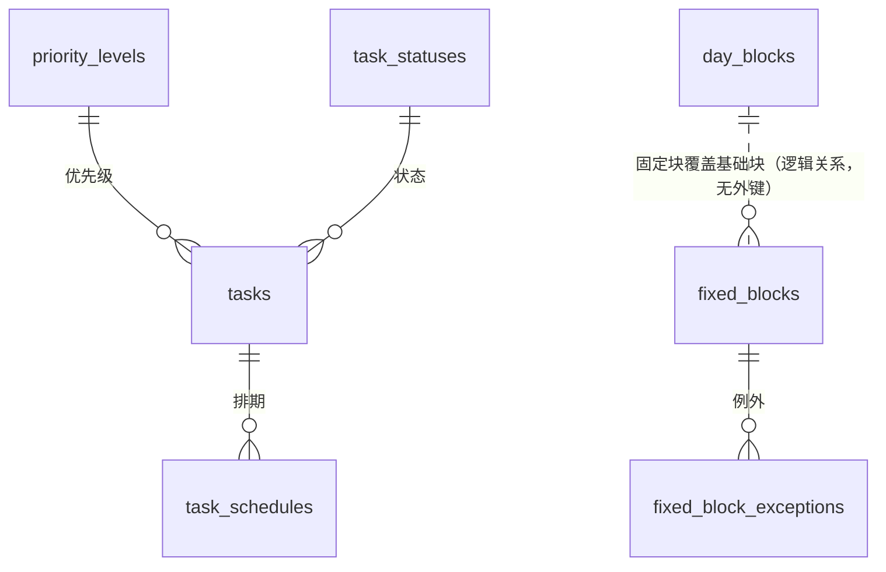

# tasks-planner 数据库设计

数据库：SQLite 3（`docs/schema.sql` 为完整建表脚本）

## 1. 总体约定

- **单用户本地模型**：当前不设 `users` 表。若将来支持多用户，各业务表需补 `user_id`，并把 `priority_levels.level` 等唯一约束改为按用户唯一。
- **时间点**统一存「距当天 00:00 的分钟数」`INTEGER`：
  - `00:00 = 0`，`24:00 = 1440`
  - `HH:MM` 转换：`H * 60 + M`
  - 区间为**左闭右开** `[start_minute, end_minute)`，因此允许 `end_minute = 1440`
- **日期**存本地日期字符串 `YYYY-MM-DD`。
- **时间戳**存 UTC，默认 `datetime('now')`；API 输出时按 `app_meta.timezone` 转成本地时间并带时区偏移，请求中不带时区的时间也按该时区解释。
- **软删除**：业务表用 `deleted_at` 标记删除，`NULL` 表示未删除；API 默认不返回已删除记录，可用 `include_deleted=true` 查看，并提供恢复接口。
- 应用每个连接都要执行 `PRAGMA foreign_keys = ON`（该设置不随数据库文件持久化）。
- 数据库使用 WAL 模式，适合守护进程读多写少。

## 2. 表关系



- `priority_levels` 1 : N `tasks`
- `task_statuses` 1 : N `tasks`
- `tasks` 1 : N `task_schedules`（可选）
- `fixed_blocks` 1 : N `fixed_block_exceptions`
- `day_blocks` 与 `fixed_blocks` 没有外键，二者在**查询时**按时间区间叠加。
- `daily_memos` 是独立表，不与其它表建立外键关系。

## 3. 表说明

### 3.1 `app_meta` 元信息

| 字段 | 类型 | 空 | 默认 | 说明 |
|---|---|---|---|---|
| `key` | TEXT | 否 | - | 主键 |
| `value` | TEXT | 否 | - | 值 |

内置键：

| key | 初始值 | 含义 |
|---|---|---|
| `schema_version` | `1` | 结构版本，供升级脚本判断 |
| `timezone` | `Asia/Shanghai` | 展示与「今天」计算所用时区 |
| `week_start` | `1` | 周起始日（ISO，1=周一），仅影响展示 |

### 3.2 `priority_levels` 优先级表

用户自行定义优先级，任务只存外键，避免在代码里写死枚举。

| 字段 | 类型 | 空 | 默认 | 说明 |
|---|---|---|---|---|
| `id` | INTEGER | 否 | 自增 | 主键 |
| `level` | INTEGER | 否 | - | 等级，`1` 最高，越大越低；未删除记录中唯一 |
| `name` | TEXT | 否 | - | 显示名，如 `P0` / `高` |
| `usage` | TEXT | 是 | NULL | 用法说明：什么情况下使用该等级 |
| `remark` | TEXT | 是 | NULL | 备注 |
| `color` | TEXT | 是 | NULL | 前端颜色，如 `#e5484d` |
| `is_active` | INTEGER | 否 | `1` | 是否启用，`0/1` |
| `deleted_at` | TEXT | 是 | NULL | 软删除时间（UTC），NULL = 未删除 |
| `created_at` | TEXT | 否 | `datetime('now')` | 创建时间（UTC） |
| `updated_at` | TEXT | 否 | `datetime('now')` | 更新时间（UTC） |

初始数据为 `P0`～`P3`，可直接修改或新增。

> 删除采用软删除，任务上的历史引用保留；`level` 的唯一索引只作用于 `deleted_at IS NULL` 的记录。

### 3.3 `task_statuses` 任务状态表

内置状态的 `id` 固定，应用可直接引用；建议用 `is_active` 停用，不要删除内置行。

| 字段 | 类型 | 空 | 默认 | 说明 |
|---|---|---|---|---|
| `id` | INTEGER | 否 | - | 主键，内置固定为 `1..5` |
| `code` | TEXT | 否 | - | 唯一代码，如 `todo`；未删除记录中唯一 |
| `name` | TEXT | 否 | - | 显示名 |
| `sort_order` | INTEGER | 否 | `0` | 展示排序 |
| `remark` | TEXT | 是 | NULL | 备注 |
| `is_active` | INTEGER | 否 | `1` | 是否启用 |
| `is_initial_filter` | INTEGER | 否 | `1` | 是否纳入任务列表的初始状态筛选，`0/1` |
| `deleted_at` | TEXT | 是 | NULL | 软删除时间（UTC），NULL = 未删除 |
| `created_at` | TEXT | 否 | `datetime('now')` | 创建时间 |
| `updated_at` | TEXT | 否 | `datetime('now')` | 更新时间 |

内置数据：

| id | code | name | is_initial_filter |
|---|---|---|---|
| `1` | `todo` | 待办 | `1` |
| `2` | `doing` | 进行中 | `1` |
| `3` | `blocked` | 阻塞 | `1` |
| `4` | `done` | 已完成 | `0` |
| `5` | `cancelled` | 已取消 | `0` |

> `tasks.status_id` 默认 `1`；内置状态不可删除，只能停用。`code` 的唯一索引只作用于 `deleted_at IS NULL` 的记录。
> `is_initial_filter` 目前仅影响任务列表页面首次打开时的默认状态筛选，不影响其他接口或页面。

### 3.4 `tasks` 任务表

| 字段 | 类型 | 空 | 默认 | 说明 |
|---|---|---|---|---|
| `id` | INTEGER | 否 | 自增 | 主键 |
| `title` | TEXT | 否 | - | 标题，非空且去除空白后不能为空 |
| `priority_level_id` | INTEGER | 是 | NULL | 外键 → `priority_levels.id`；空表示未分级 |
| `status_id` | INTEGER | 否 | `1` | 外键 → `task_statuses.id` |
| `deadline_at` | TEXT | 是 | NULL | 截止时间（UTC ISO），空表示无截止时间 |
| `progress` | TEXT | 是 | NULL | 进度，纯文字描述 |
| `remark` | TEXT | 是 | NULL | 备注 |
| `created_at` | TEXT | 否 | `datetime('now')` | 创建时间 |
| `updated_at` | TEXT | 否 | `datetime('now')` | 更新时间 |
| `completed_at` | TEXT | 是 | NULL | 完成时间，状态改为 `done` 时写入 |
| `deleted_at` | TEXT | 是 | NULL | 软删除时间（UTC），NULL = 未删除 |

索引：

- `idx_tasks_deadline`：按截止时间查询（仅非空行）。
- `idx_tasks_status_priority`：按状态 + 优先级筛选。

> 阻塞原因不单独建字段，写在 `progress` 或 `remark` 中。

### 3.5 `day_blocks` 每日基础划分

**全库共用一份模板，每天都一样**。每行是当天的一个时间段。

| 字段 | 类型 | 空 | 默认 | 说明 |
|---|---|---|---|---|
| `id` | INTEGER | 否 | 自增 | 主键 |
| `start_minute` | INTEGER | 否 | - | 开始分钟，`0..1439` |
| `end_minute` | INTEGER | 否 | - | 结束分钟，`1..1440`，必须大于开始 |
| `label` | TEXT | 是 | NULL | 名称，如「上午工作」「午休」 |
| `kind` | TEXT | 是 | NULL | 自定义分类，如 `work` / `rest` / `sleep` |
| `remark` | TEXT | 是 | NULL | 备注 |
| `is_active` | INTEGER | 否 | `1` | 是否启用 |
| `deleted_at` | TEXT | 是 | NULL | 软删除时间（UTC），NULL = 未删除 |
| `created_at` | TEXT | 否 | `datetime('now')` | 创建时间 |
| `updated_at` | TEXT | 否 | `datetime('now')` | 更新时间 |

约束：

- `start_minute` 在未删除记录中唯一。
- 触发器 `trg_day_blocks_no_overlap_*` 禁止**未删除且启用**的块互相重叠（插入和更新时检查）。
- 不强制铺满 24 小时；没有块覆盖的间隙表示「未规划时间」。

示例：

```sql
INSERT INTO day_blocks(start_minute, end_minute, label, kind) VALUES
  (  0, 420, '睡眠',   'sleep'),
  (420, 480, '早间',   'free'),
  (480, 720, '上午工作', 'work'),
  (720, 780, '午休',   'rest'),
  (780, 1080, '下午工作', 'work'),
  (1080, 1440, '自由时间', 'free');
```

### 3.6 `fixed_blocks` 固定块（每日 / 每周 / 每月）

固定块会**占据对应时间**，优先级高于 `day_blocks`（即需求中的「3 比 4 优先级高」）。

| 字段 | 类型 | 空 | 默认 | 说明 |
|---|---|---|---|---|
| `id` | INTEGER | 否 | 自增 | 主键 |
| `title` | TEXT | 否 | - | 名称，如「周会」「健身」 |
| `recurrence` | TEXT | 否 | - | `daily` / `weekly` / `monthly` |
| `recurrence_value` | INTEGER | 是 | NULL | 循环值，含义由 `recurrence` 决定，见下表 |
| `start_minute` | INTEGER | 否 | - | 开始分钟，`0..1439` |
| `end_minute` | INTEGER | 否 | - | 结束分钟，`1..1440`，必须大于开始 |
| `effective_from` | TEXT | 是 | NULL | 生效起始日期（含），`YYYY-MM-DD` |
| `effective_to` | TEXT | 是 | NULL | 生效结束日期（含） |
| `overlap_priority` | INTEGER | 否 | `0` | 固定块之间冲突时裁决，越大越优先 |
| `allow_task_schedule` | INTEGER | 否 | `1` | 是否允许在该固定块时段内添加任务排期；`0` = 不允许 |
| `remark` | TEXT | 是 | NULL | 备注 |
| `is_active` | INTEGER | 否 | `1` | 是否启用 |
| `deleted_at` | TEXT | 是 | NULL | 软删除时间（UTC），NULL = 未删除 |
| `created_at` | TEXT | 否 | `datetime('now')` | 创建时间 |
| `updated_at` | TEXT | 否 | `datetime('now')` | 更新时间 |

`recurrence` 与 `recurrence_value` 的合法组合由 CHECK 约束保证：

| recurrence | recurrence_value |
|---|---|
| `daily` | NULL |
| `weekly` | 必填，`1..7`（ISO，`1=周一` … `7=周日`） |
| `monthly` | 必填，`1..31` |

其他规则：

- 周一、周三、周五各来一次 → 建 3 行，不引入子表。
- `effective_from` / `effective_to` 为空表示长期有效；起止都含端点。
- 每月 29/30/31 日的块，在不存在该日的月份**当月跳过**，不顺延。
- 不支持跨午夜；如 23:00–次日 01:00，拆成 `23:00–24:00` 和 `00:00–01:00` 两行（后者为 daily）。
- 固定块之间允许重叠，读取时按 `overlap_priority DESC, id ASC` 排序，靠前者覆盖靠后者。
- `allow_task_schedule` 控制任务排期能否与固定块时段重叠；`0` 表示该固定块内不允许添加任务排期。
- 固定块本身不会被其他项自动覆盖，始终占据自身时段；`fixed_block_exceptions` 属于显式操作，直接生效。

### 3.7 `daily_memos` 每日备忘录

用于记录当天的临时想法、提醒或复盘，不参与时间计算。同一天可以有多条。备忘录**只允许新增**，不提供修改和删除接口。

| 字段 | 类型 | 空 | 默认 | 说明 |
|---|---|---|---|---|
| `id` | INTEGER | 否 | 自增 | 主键 |
| `memo_date` | TEXT | 否 | - | 本地日期 `YYYY-MM-DD`，允许同一天多条 |
| `content` | TEXT | 否 | - | 备忘录内容，去除空白后不能为空 |
| `deleted_at` | TEXT | 是 | NULL | 预留字段；接口不提供删除，正常记录始终为 NULL |
| `created_at` | TEXT | 否 | `datetime('now')` | 创建时间 |
| `updated_at` | TEXT | 否 | `datetime('now')` | 更新时间 |

索引：

- `idx_daily_memos_date`：按日期范围查询，不限制同一天条数。

> 接口支持新增和按天、周、月查询：`POST /api/memos`、`GET /api/memos?period=day|week|month&date=YYYY-MM-DD`。周范围按 `app_meta.week_start` 计算。

### 3.8 `task_schedules` 任务排期（可选）

用于把任务放进某天的具体时段，支撑日历 / 时间轴视图。暂不需要可删除本节对应建表语句。

| 字段 | 类型 | 空 | 默认 | 说明 |
|---|---|---|---|---|
| `id` | INTEGER | 否 | 自增 | 主键 |
| `task_id` | INTEGER | 否 | - | 外键 → `tasks.id`，任务物理删除时级联删除 |
| `plan_date` | TEXT | 否 | - | 本地日期 `YYYY-MM-DD` |
| `start_minute` | INTEGER | 否 | - | 开始分钟 |
| `end_minute` | INTEGER | 否 | - | 结束分钟，必须大于开始 |
| `status` | TEXT | 否 | `'planned'` | `planned` / `done` / `skipped` |
| `allow_override` | INTEGER | 否 | `1` | 是否允许被同层更高优先级任务自动挤占；`0` = 锁定 |
| `note` | TEXT | 是 | NULL | 备注 |
| `deleted_at` | TEXT | 是 | NULL | 软删除时间（UTC），NULL = 未删除 |
| `created_at` | TEXT | 否 | `datetime('now')` | 创建时间 |
| `updated_at` | TEXT | 否 | `datetime('now')` | 更新时间 |

索引：`(plan_date, start_minute)`、`task_id`。

> 任务和排期都采用软删除；所属任务已删除时，排期默认不返回，恢复任务后重新可见。

> 新建或更新排期时，接口会校验冲突：与 `allow_task_schedule = 0` 的固定块重叠，或与同一天未删除、未跳过的其他排期重叠时返回 `409 Conflict` 并列出冲突项。`status = skipped` 的排期不参与冲突检查。

### 3.9 `fixed_block_exceptions` 固定块例外

用于在特定日期范围内**跳过**某个固定块，也可以只跳过其中一段时间，常见于节假日、调休、临时冲突。

| 字段 | 类型 | 空 | 默认 | 说明 |
|---|---|---|---|---|
| `id` | INTEGER | 否 | 自增 | 主键 |
| `fixed_block_id` | INTEGER | 否 | - | 外键 → `fixed_blocks.id`，物理删除时级联删除 |
| `effective_from` | TEXT | 是 | NULL | 例外生效起始日期（含），`YYYY-MM-DD` |
| `effective_to` | TEXT | 是 | NULL | 例外生效结束日期（含） |
| `skip_date` | TEXT | 是 | NULL | 只匹配该具体日期 |
| `weekday` | INTEGER | 是 | NULL | 只匹配该 ISO 星期，`1..7` |
| `day_of_month` | INTEGER | 是 | NULL | 只匹配该日号，`1..31` |
| `start_minute` | INTEGER | 是 | NULL | 可空；与 `end_minute` 同时为空时跳过整个固定块 |
| `end_minute` | INTEGER | 是 | NULL | 可空；填写时只跳过与该时段重叠的部分 |
| `remark` | TEXT | 是 | NULL | 备注，如「国庆放假」 |
| `is_active` | INTEGER | 否 | `1` | 是否启用 |
| `deleted_at` | TEXT | 是 | NULL | 软删除时间（UTC），NULL = 未删除 |
| `created_at` | TEXT | 否 | `datetime('now')` | 创建时间 |
| `updated_at` | TEXT | 否 | `datetime('now')` | 更新时间 |

匹配规则：

- 固定块在日期 `D` 发生，且该行 `is_active = 1`。
- `D` 在 `[effective_from, effective_to]` 内（NULL 表示不限）。
- `skip_date` / `weekday` / `day_of_month` 中**非空的条件必须全部满足**（AND）。
- 三个日期条件全为 NULL 时，表示范围内该固定块的**每次发生**都命中。
- 多条命中时，跳过区间取并集；排序仅用于稳定输出：具体日期 > day_of_month > weekday > 无日期条件，再按 `id ASC`。

时段约束（由 CHECK 保证）：

- `start_minute` / `end_minute` 必须同时为空，或同时填写。
- 填写时 `end_minute > start_minute`。

示例：

```sql
-- 2026-12-25 跳过整个周会
INSERT INTO fixed_block_exceptions(fixed_block_id, skip_date, remark)
VALUES (1, '2026-12-25', '圣诞节');

-- 每周五都跳过周会
INSERT INTO fixed_block_exceptions(fixed_block_id, weekday)
VALUES (1, 5);

-- 国庆期间全部跳过
INSERT INTO fixed_block_exceptions(fixed_block_id, effective_from, effective_to, remark)
VALUES (1, '2026-10-01', '2026-10-07', '国庆假期');

-- 每周五只跳过 10:20-10:40（假设周会为 10:00-11:00）
INSERT INTO fixed_block_exceptions(fixed_block_id, weekday, start_minute, end_minute)
VALUES (1, 5, 620, 640);
```

> 例外是用户显式操作，直接生效，**不受** `fixed_blocks.allow_task_schedule` 限制。固定块软删除后，其例外默认不返回；恢复固定块后继续生效。

### 3.10 软删除约定

所有业务表都有 `deleted_at`：

- `NULL`：正常记录。
- 非空：已软删除；时间戳为 UTC。
- 删除接口只写入 `deleted_at`，不物理删除数据。
- 列表默认过滤 `deleted_at IS NULL`，传 `include_deleted=true` 可查看。
- 恢复接口把 `deleted_at` 置回 `NULL`。
- `task_statuses.code`、`priority_levels.level`、`day_blocks.start_minute` 的唯一性只作用于未删除记录，删除后可以复用。
- `daily_memos` 只支持新增和查询，不提供修改、删除接口；同一天可以新增多条。
- 父记录删除后的默认可见性：
  - 任务删除后，其 `task_schedules` 默认不返回。
  - 固定块删除后，其 `fixed_block_exceptions` 默认不返回。

## 4. 固定块覆盖基础块的计算方式

数据库**不做物理合并**，每次按日期实时计算，避免重复数据和同步问题。

给定日期 `D`：

1. 取出所有未删除且启用的 `day_blocks`，得到基础区间集合。
2. 按 `D` 匹配未删除且启用的 `fixed_blocks`：`daily` 全部命中；`weekly` 用 `recurrence_value` 匹配 ISO 星期；`monthly` 用 `recurrence_value` 匹配日号；同时满足生效区间。
3. 对命中的固定块应用未删除且启用的 `fixed_block_exceptions`：按匹配条件计算需要跳过的区间（未填 `start_minute` / `end_minute` 时跳过整个块），从固定块区间中扣除。
4. 固定块按 `overlap_priority DESC, id ASC` 排序，依次「切走」基础区间；固定块之间不自动让出。
5. 剩余的基础区间为自由时间；固定块区间标记为占用。
6. 未删除的 `task_schedules` 可以放进自由区间，以及 `allow_task_schedule = 1` 的固定块时段；若与不允许叠加的固定块重叠，则报告冲突。同层内 `allow_override = 1` 的任务可被更高优先级任务自动挤占，`0` 则锁定。

示例（2026-11-20 周五）：

```text
day_blocks:   09:00-12:00 工作
fixed_blocks: 10:00-11:00 周会（weekly, recurrence_value=5）

结果:
  09:00-10:00  自由（工作模板剩余）
  10:00-11:00  周会（占用，固定块优先）
  11:00-12:00  自由（工作模板剩余）
```

固定块超出模板范围时也照常占用，例如模板只到 22:00、固定块 21:00–23:00，则 22:00–23:00 仍为占用。

### 4.1 冲突裁决顺序

从低到高：

1. `day_blocks` 基础模板
2. `task_schedules` 任务排期
3. `fixed_blocks` 固定块

同层内：

- 固定块之间：`overlap_priority` 大者优先，相同则 `id` 小者优先。
- 任务排期之间：任务优先级高者优先（再按 `created_at`、`id`）。

`allow_task_schedule` 的作用（固定块）：

- `1`：允许任务排期与该固定块时段重叠，即可以在固定块内添加任务排期。
- `0`：禁止在该固定块内添加任务排期；出现重叠时保留固定块并报告冲突。
- 固定块本身不会被自动覆盖；`fixed_block_exceptions` 属于显式操作，直接生效。

`allow_override` 的作用（任务排期）：

- `1`：允许被同层更高优先级的任务自动挤占。
- `0`：锁定，自动排期不得挤占；出现冲突时保留原排期并提示用户手动处理。
- 用户手动修改属于显式操作，不受此限制。

匹配某天的固定块：

```sql
SELECT *
FROM fixed_blocks
WHERE is_active = 1
  AND deleted_at IS NULL
  AND (effective_from IS NULL OR effective_from <= :date)
  AND (effective_to   IS NULL OR effective_to   >= :date)
  AND (
        recurrence = 'daily'
    OR (recurrence = 'weekly'  AND recurrence_value = :iso_weekday)
    OR (recurrence = 'monthly' AND recurrence_value = :day_of_month)
  )
ORDER BY overlap_priority DESC, id ASC;
```

匹配某天命中的例外：

```sql
SELECT *
FROM fixed_block_exceptions
WHERE fixed_block_id = :block_id
  AND is_active = 1
  AND deleted_at IS NULL
  AND (effective_from IS NULL OR effective_from <= :date)
  AND (effective_to   IS NULL OR effective_to   >= :date)
  AND (skip_date      IS NULL OR skip_date      = :date)
  AND (weekday        IS NULL OR weekday        = :iso_weekday)
  AND (day_of_month   IS NULL OR day_of_month   = :day_of_month)
ORDER BY
  (skip_date IS NOT NULL) DESC,
  (day_of_month IS NOT NULL) DESC,
  (weekday IS NOT NULL) DESC,
  id ASC;
```

## 5. 常用查询

按优先级、截止时间列出待办（无截止时间的排最后）：

```sql
SELECT t.*, s.code AS status, s.name AS status_name,
       p.level, p.name AS priority_name, p.usage, p.remark AS priority_remark
FROM tasks t
JOIN task_statuses s ON s.id = t.status_id
LEFT JOIN priority_levels p ON p.id = t.priority_level_id
WHERE t.deleted_at IS NULL
  AND s.code IN ('todo', 'doing', 'blocked')
ORDER BY
  COALESCE(p.level, 9999),
  t.deadline_at IS NULL,
  t.deadline_at;
```

查询某天的任务排期：

```sql
SELECT s.*, t.title, t.progress
FROM task_schedules s
JOIN tasks t ON t.id = s.task_id
WHERE s.plan_date = :date
ORDER BY s.start_minute;
```

按天 / 周 / 月查询备忘录：

```sql
-- 某天
SELECT * FROM daily_memos
WHERE memo_date = :date AND deleted_at IS NULL
ORDER BY id;

-- 某周（起止日期由 app_meta.week_start 与基准日期算出）
SELECT * FROM daily_memos
WHERE memo_date BETWEEN :start AND :end AND deleted_at IS NULL
ORDER BY memo_date;

-- 某月
SELECT * FROM daily_memos
WHERE memo_date BETWEEN :month_start AND :month_end AND deleted_at IS NULL
ORDER BY memo_date;
```

## 6. 初始化

```bash
sqlite3 tasks-planner.db < docs/schema.sql
```

脚本可重复执行（`IF NOT EXISTS`、`INSERT OR IGNORE`）。升级时读取 `app_meta.schema_version`，按版本顺序执行迁移。

> `IF NOT EXISTS` 只保证不报错，不会修改已存在表的结构。若之前用旧版脚本建过库，需要删除重建或编写迁移脚本。

## 7. 后续可扩展

- `task_progress_logs`：保留进度变更历史。
- `tags` / `task_tags`：任务标签与筛选。
- 多用户：补 `user_id`，并调整唯一约束与查询范围。
